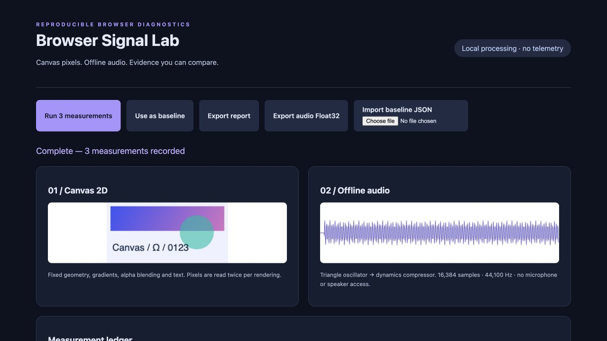

# Browser Signal Lab

A small browser-output diagnostic harness with a C++20 audio comparison tool. It records reproducible Canvas 2D and OfflineAudioContext fixtures, retains their raw output, and compares a subsequent run with a baseline.



## Run locally

No npm dependencies or build step are needed for the browser harness. Use Python 3:

```sh
python3 -m http.server 8765 --bind 127.0.0.1 --directory web
```

Open http://127.0.0.1:8765 and click **Run 3 measurements**. Choose **Use as baseline**, then run again. Alternatively import an exported JSON baseline from another build. Measurement requires a secure context (localhost or HTTPS) for SHA-256.

- Canvas: 256 × 128 RGBA pixels, fixed geometry, gradients, alpha and text; two reads per render.
- Audio: mono triangle oscillator at 1 kHz through a dynamics compressor, 16,384 samples at 44.1 kHz.
- SHA-256 ledger identifies repeatability within the three runs.
- Baseline comparison uses the **first run** of each report, with exact pixel comparison and an absolute audio tolerance of 1e-7.
- JSON exports include all three raw pixel/audio buffers in base64 and basic environment metadata. Review metadata before sharing. Audio export is the first run, IEEE Float32 little endian.

No microphone, speaker, external service, or telemetry is used. Measurements start only on request.

## Native C++ comparator

Requires CMake 3.20+ and a C++20 compiler:

```sh
cmake -S . -B build
cmake --build build
./build/signal-compare baseline.f32le current.f32le 0.0000001
```

For Windows multi-configuration generators, use `build/Debug/signal-compare.exe` (or Release). The tool reports sample count, number of differences above tolerance, maximum absolute error and RMSE. Exit codes: **0** within tolerance, **1** differences, **2** invalid input or arguments. Input files must be non-empty finite Float32 little-endian samples with equal lengths. No WAV header is accepted.

## Validation

```sh
node --test tests/metrics.test.mjs
python3 tests/native_test.py build/signal-compare
```

The C++ tool was built with AppleClang 21 on macOS. Tests cover identical/changed samples, tolerances, truncated or non-finite data, and invalid arguments. Browser checks covered two three-run batches, baseline comparison, JSON/audio export, and JSON re-import. Both batches produced stable hashes on the tested Mac browser; baseline differences were zero. The exported 16,384-sample file also passed native self-comparison. See [recorded results](docs/validation.json).

## Scope and investigation workflow

This repository contains a **public-API diagnostic harness**, not a Chromium/Blink source patch. It does not establish past Chromium development experience, diagnose a native root cause, or certify that a browser is spoofed/undetectable. No Android ARM64 build or device test has been performed. C++ comparator portability has not yet been validated on Windows or Android.

Cross-device or cross-version output differences can be legitimate, especially from fonts, platform rendering and audio implementation. Keep the device, OS, font environment and browser configuration fixed when comparing builds. Metadata describes the browser's reported environment, not verified hardware identity.

For a custom Chromium investigation:

1. Pin baseline and custom source revisions, build flags, device, OS and fonts; collect exact repro steps and expected/observed behavior.
2. Run this fixture on both builds and preserve reports. Use the native comparator for exported samples.
3. If a difference is confirmed, reproduce using a reduced engine test; correlate it with native traces and source paths in Canvas/Skia or Web Audio. The harness alone cannot identify those functions.
4. Review the finding before choosing a patch. Add an engine regression test and validate on the target Android ARM64 device as separate work.

Public API references: [Canvas getImageData](https://developer.mozilla.org/en-US/docs/Web/API/CanvasRenderingContext2D/getImageData), [OfflineAudioContext](https://developer.mozilla.org/en-US/docs/Web/API/OfflineAudioContext).
